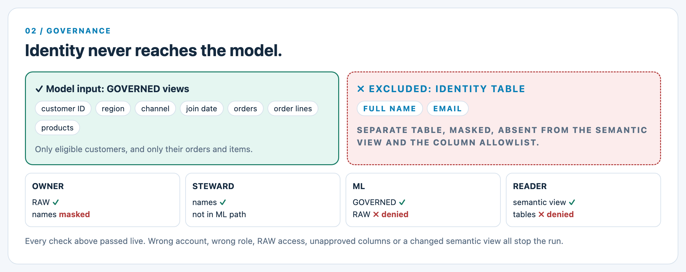
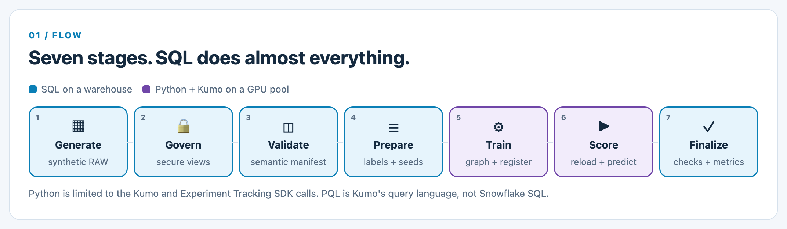
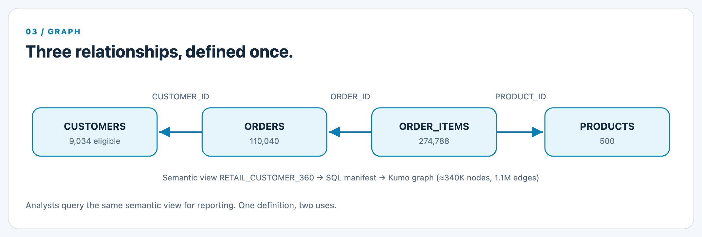
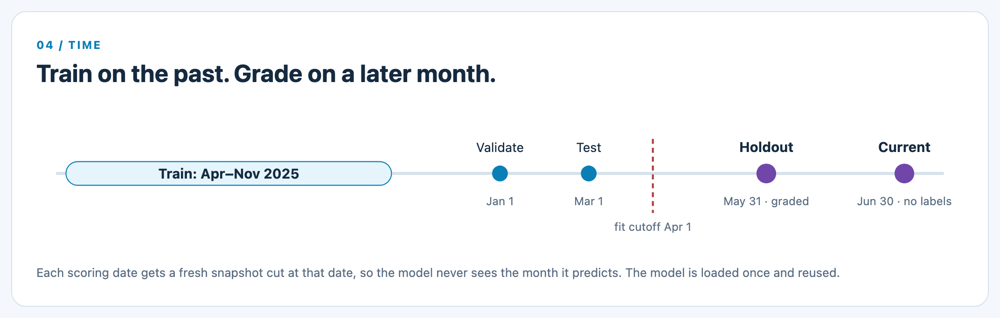
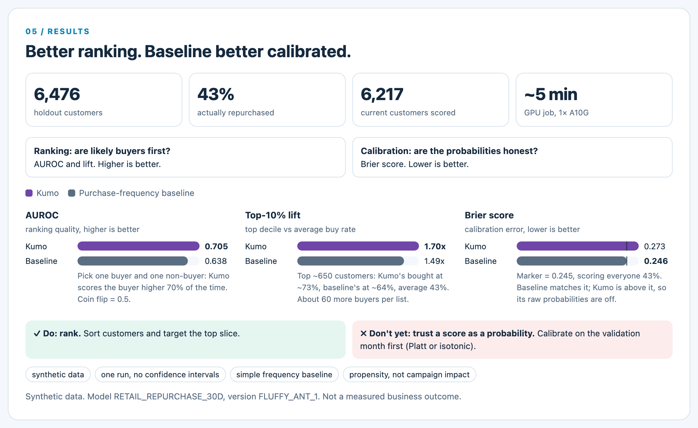
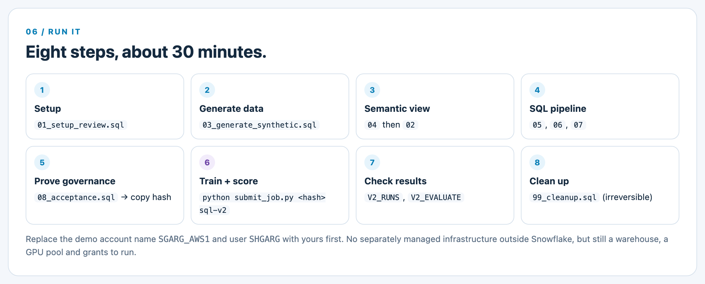

# Predicting Repeat Customers with NVIDIA Kumo on Snowflake. No Feature Engineering, No Data Leaving the Platform.

*A hands-on build: governed retail data, a semantic view, a graph neural network, and batch predictions, all inside Snowflake.*

---

## The retail question every marketing team asks

Which customers will buy again in the next 30 days?

It sounds simple. It drives real money: who gets the win-back email, who gets the discount, who you leave alone. And it's a question retailers have been answering the same way for years.

### The traditional playbook

1. Join customers, orders, order items and products into one wide table.
2. Hand-build features. Orders in the last 30, 60, 90 days. Average basket size. Days since last purchase. Favorite category.
3. Train a gradient-boosted tree on that table.
4. Rebuild most of it when the business asks the next question.

That works. It also throws information away. "4 orders in 90 days" says nothing about *what* was bought, *in what order*, or how those products behave across every other customer who bought them. Every feature is a guess about what matters, made by a person, before the model sees anything.

## Why Kumo is different for this use case

Kumo skips the flattening step. It treats the database as what it already is: a graph.

- **Every row becomes a node.** A customer, an order, an order line, a product.
- **Every foreign key becomes an edge.** Order => customer. Order line => order. Order line => product.
- **A graph neural network learns across those connections,** respecting time.

### Why that matters for repurchase

- **Product signal travels.** A customer who bought products that *other* repeat buyers also bought carries signal a per-customer count never captures. That's two hops away in the graph. Painful to hand-engineer, natural for a GNN.
- **Sequence survives.** The model sees individual orders with timestamps, not a pre-aggregated total.
- **New questions are cheap.** Churn, next category, lifetime value. Change the prediction query, not the feature pipeline.

### The whole prediction, in one statement

Kumo's Predictive Query Language (PQL):

```
PREDICT COUNT(ORDERS.*, 0, 30, days) > 0
FOR EACH CUSTOMERS.CUSTOMER_ID
WHERE COUNT(ORDERS.*, -90, 0, days) > 0
```

In plain English: for every customer who bought in the last 90 days, will they buy again in the next 30? PQL looks like SQL. It isn't. It runs through Kumo, not the Snowflake SQL engine.

> One honest caveat up front: this is a propensity score. It tells you who is likely to buy. It doesn't prove that sending an offer changes behavior. That's a different experiment.

## The research and the launch behind it

None of this is new science. It's new packaging.

The method is called [Relational Deep Learning](https://kumo.ai/research/relational-deep-learning-rdl/), from the Kumo team and Stanford. [Their paper](https://arxiv.org/abs/2312.04615) frames a relational database as a temporal graph and trains GNNs on it directly. They also released [RelBench](https://kumo.ai/research/relbench-guide/), a public benchmark of 30 tasks across 7 real databases, comparing GNNs against an experienced data scientist hand-engineering features for LightGBM.

On October 21, NVIDIA (which acquired Kumo earlier this year) launched the [Kumo family of open models](https://developer.nvidia.com/topics/ai/agent-knowledge-foundation/kumo) and the open-source Kumo Engine. [Snowflake announced](https://www.snowflake.com/en/blog/nvidia-kumo-graph-ml-snowflake/) the same day that Kumo Engine runs on Snowflake ML. No separate Kumo account. No API key. Install the package in a Snowflake GPU runtime and go.

The [Snowflake quickstart](https://www.snowflake.com/en/developers/guides/getting-started-with-nvidia-kumo-graph-neural-networks-in-snowflake/) shows the mechanics. I wanted to answer the next question: what does a *properly governed* version look like, the kind you could show a security team?

## The architecture a real system needs

A notebook that trains a model isn't a system. Five things have to be true before anyone should trust the predictions. Here's each one and the Snowflake piece that covers it:

```
NEED                  SNOWFLAKE COMPONENT
--------------------  ------------------------------------
Governed inputs       Secure views, masking policy, roles
One definition        Semantic view RETAIL_CUSTOMER_360
GPU compute           ML Job on a GPU compute pool
Model lifecycle       Model Registry + Experiment Tracking
Honest evaluation     SQL procedures on a warehouse
```

### 1. Governed inputs => secure views, masking and roles

Raw tables sit in a RAW schema. Secure views in a GOVERNED schema expose only approved columns and only ML-eligible customers, including their orders and items, so excluded customers can't sneak back in as graph neighbors. Names and emails live in a separate, masked identity table. The ML role can't read RAW at all.

**Advantage:** access control is the same RBAC you already run. Not a new system to audit.



### 2. One definition => a Snowflake semantic view

The semantic view `RETAIL_CUSTOMER_360` declares the tables, keys and the three relationships. Analysts use it for reporting. The pipeline reads the same definition with `DESCRIBE SEMANTIC VIEW`, validates it in SQL, and builds the Kumo graph from it.

**Advantage:** one relationship definition, two uses. Report what happened. Predict what happens next.

### 3. GPU compute => ML Jobs on a GPU compute pool

The training code runs as a Snowflake ML Job on a dedicated single-node GPU pool (NVIDIA A10G). A PyPI-only external access integration lets it install `kumo-engine`. It authenticates with the runtime's own identity.

**Advantage:** no separately managed infrastructure outside Snowflake. The pool auto-suspends.

### 4. Model lifecycle => Model Registry and Experiment Tracking

Every trained model is published as a new version in the Model Registry, then reloaded by exact version for scoring. Parameters, the semantic definition's fingerprint and holdout metrics go to Experiment Tracking.

**Advantage:** "which model made this prediction?" has a query-able answer.

### 5. Honest evaluation => SQL

Labels, training populations, the baseline, output validation and every metric are SQL. Python only does what only the Kumo SDK can do.

**Advantage:** the logic that decides whether the model is any good is readable, reviewable and runs on a warehouse.

> "No separately managed infrastructure" isn't "no infrastructure." There's still a warehouse, a GPU pool, packages and grants. And it isn't zero-copy: Kumo materializes a graph snapshot in the runtime. Changing a masking policy later doesn't erase an existing snapshot or what a model already learned.

## The flow, end to end



1. **Generate and govern (SQL).** Synthetic customers, orders, items and products land in RAW. Secure views filter them to approved columns and eligible customers.
2. **Define semantics (SQL).** A native semantic view declares the three relationships.
3. **Validate (SQL).** A procedure reads the semantic view, rejects anything outside an approved column list, checks keys against the data, and returns a fingerprinted manifest. Change the semantic view mid-run => the run stops.
4. **Prepare (SQL).** Training labels at monthly anchor dates, a validation month, a test month, scoring populations and a purchase-frequency baseline.
5. **Train (Python, Kumo SDK).** Build the graph from the manifest, train one bounded run (5 epochs), publish to the Model Registry.
6. **Score (Python, Kumo SDK).** Reload the exact model version. Build a fresh snapshot for each scoring date and predict.
7. **Finalize (SQL).** Check every expected customer got exactly one valid score, write result tables, compute holdout metrics.

### The graph Kumo learns from



Three relationships, straight from the semantic view. In the run below that became a graph of about 340,000 nodes and 1.1 million edges.

### Why time is the hard part



Leakage is the classic way a churn model looks brilliant in a notebook and useless in production. So:

- **Training stops at April 1.** The holdout period never enters training.
- **Every scoring date gets its own snapshot,** cut off at that date. May 31 scoring sees nothing from June, the month it's predicting.
- **Holdout is graded, current is the output.** The holdout batch is checked against what customers actually did. The current batch has no labels, because it's the future.

## What the run showed

All data is synthetic. Both models scored the same 6,476 holdout customers as of May 31. Then we checked who actually bought in June: 43% did.

> Kumo's top 10% bought again at about 73%. The baseline's top 10% at about 64%. Same list size, roughly 60 more real buyers.



```
METRIC                 KUMO    BASELINE   BETTER
---------------------  ------  --------   ------
AUROC                  0.705   0.638      higher
Average precision      0.632   0.549      higher
Top-10% lift           1.70x   1.49x      higher
Brier score            0.273   0.246      lower
```

### How to read these numbers

The metrics answer two different questions. A model can be good at one and bad at the other.

#### Question 1: does it put likely buyers first? (ranking)

- **AUROC.** Pick one customer who bought and one who didn't. How often does the model score the buyer higher? 0.5 is a coin flip, 1.0 is perfect. Kumo gets that pair right about 70% of the time, the baseline about 64%. Solid for a 30-day purchase prediction. Not magic.
- **Top-10% lift.** The most business-friendly number. Take the top-scored 10%, about 650 customers, and compare their buy rate to the 43% average. 1.70x => about 73%.
- **Average precision.** How pure the list stays as you work down it. Random ordering would score 0.43, the base rate. Both beat random; Kumo by more.

#### Question 2: are the probabilities honest? (calibration)

- **Brier score.** The average squared gap between predicted probability and what happened. Lower is better.
- **The yardstick is 0.245.** That's what you get by giving every customer the same 43% score.
- **The baseline lands on it. Kumo lands above it.** Kumo's ordering is better, but its probability numbers are off. Likely reasons: training months had different purchase rates, only 5 epochs, and no calibration step.

### What that means in practice

- **Do** use Kumo's scores to sort customers. "Target the top 20%" is the right kind of decision.
- **Don't** use a raw score as a probability yet. "73% likely, so spend up to $X" would mislead you.
- **Fix it** with a calibration step (Platt scaling or isotonic regression) fitted on the validation month. Ranking stays, numbers become trustworthy.

### How much to read into it

- **Synthetic data.** It proves the pipeline works, not the size of the gain on a real retailer.
- **One run.** No confidence intervals or repeats. A 0.067 AUROC gap on 6,476 customers is probably real, but I didn't measure the uncertainty.
- **Simple baseline.** A purchase-frequency count, not a tuned gradient-boosted model. Beating it is a floor.
- **Propensity, not impact.** These scores say who will buy, not who will buy *because* you contacted them. That needs a holdout campaign.

### Run facts

- One NVIDIA A10G, kumo-engine 1.0.0, 5 training epochs, about 5 minutes for the successful job.
- 6,217 current customers scored, none missing, no names or emails anywhere in the outputs.
- Two things broke on the way. Kumo rejected decimal-number keys and a decimal-typed split column. Both fixed by casting in SQL: keys to strings, the split to a float.

## Hands-on lab: run it yourself

Code: [INSERT LINK TO CODE REPOSITORY]



### What you need

- A Snowflake account with ACCOUNTADMIN for the one-time setup
- GPU compute pool access (GPU_NV_S)
- Python 3.12 locally with `snowflake-ml-python`, plus the Snowflake CLI
- About 30 minutes, most of it waiting on the GPU

> Before running anything, replace the demo account name <YOUR_ACCOUNT> (a safety guard in the SQL scripts and job_entry.py) with your account name, and the user <YOUR_USER> in the grants with yours.

### Step 1: Set up roles, compute and governance

Creates four roles (owner, identity steward, ML, reader), an X-Small warehouse, a single-node GPU pool, a PyPI-only network integration, the RAW and GOVERNED objects, and the masking policy. Review it before running.

```
snow sql -c <connection> -f sql/01_setup_review.sql
```

### Step 2: Generate the synthetic data

Runs as KUMO_DEMO_OWNER. Deterministic, about 30 seconds. It refuses to run against tables that already have data.

```
snow sql -c <connection> -f sql/03_generate_synthetic.sql
```

### Step 3: Create the semantic view

```
snow sql -c <connection> -f sql/04_semantic_view.sql
snow sql -c <connection> -f sql/02_semantic_queries.sql
```

Then try it:

```
SELECT * FROM SEMANTIC_VIEW(
  KUMO_SEMANTIC_DEMO.SEMANTIC.RETAIL_CUSTOMER_360
  METRICS ORDERS.SALES);
```

### Step 4: Install the SQL pipeline

In this order, as KUMO_DEMO_OWNER:

```
snow sql -c <connection> -f sql/05_contracts.sql
snow sql -c <connection> -f sql/06_prepare.sql
snow sql -c <connection> -f sql/07_finalize.sql
```

### Step 5: Prove the governance

```
snow sql -c <connection> -f sql/08_acceptance.sql
```

You should see the owner role get 0 visible names, the steward see all of them, and the ML role pass its data checks. The last call returns the semantic manifest. Copy its semantic_hash. That's your approval of exactly what the model will see.

### Step 6: Train and score on the GPU

From the repo root. It uploads the code, runs it as a Snowflake ML Job on the GPU pool, waits, and prints the logs.

```
python submit_job.py <semantic_hash> sql-v2
```

### Step 7: Look at the results

```
SELECT run_id, status, model_version
FROM KUMO_SEMANTIC_DEMO.RESULTS.V2_RUNS;

CALL KUMO_SEMANTIC_DEMO.RESULTS.V2_EVALUATE(
  '<your account name>',
  'KUMO_SEMANTIC_DEMO.RESULTS.RETAIL_HOLDOUT_<run_id>');
```

Then open the Model Registry and Experiment Tracking in Snowsight and find your run.

### Step 8: Clean up

Suspend the pool and warehouse when you're done. To remove everything, run this as ACCOUNTADMIN. It's irreversible: data, models and predictions all go.

```
snow sql -c <connection> -f sql/99_cleanup.sql
```

## Takeaways

1. For relational problems like repurchase, a GNN on the raw graph skips the feature-engineering cycle, and kept more signal than a frequency baseline in this demo.
2. Kumo Engine on Snowflake means the GPU work happens next to governed data, under the same roles and audit trail.
3. Define relationships once in a semantic view. Use them for analytics and for ML.
4. Keep evaluation logic in SQL, and check calibration before acting on probabilities.

*Synthetic data. Results describe this demo, not a measured business outcome.*

---

### Sources

- Snowflake: Scaling Graph ML with NVIDIA Kumo on Snowflake ML: https://www.snowflake.com/en/blog/nvidia-kumo-graph-ml-snowflake/
- Snowflake quickstart: https://www.snowflake.com/en/developers/guides/getting-started-with-nvidia-kumo-graph-neural-networks-in-snowflake/
- NVIDIA Kumo: https://developer.nvidia.com/topics/ai/agent-knowledge-foundation/kumo
- NVIDIA Kumo Engine docs: https://docs.nvidia.com/sdgm/kumo-engine/1.0.0/get-started-with-kumo-engine/overview
- Kumo: Relational Deep Learning: https://kumo.ai/research/relational-deep-learning-rdl/
- Relational Deep Learning paper: https://arxiv.org/abs/2312.04615
- Kumo: RelBench guide: https://kumo.ai/research/relbench-guide/
- Snowflake semantic views: https://docs.snowflake.com/en/user-guide/views-semantic/best-practices-dev
